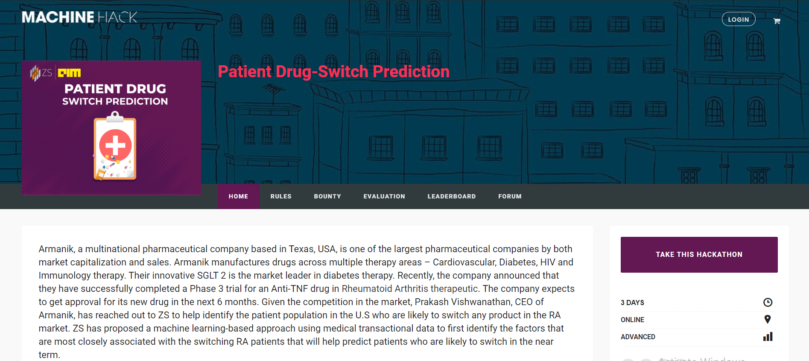
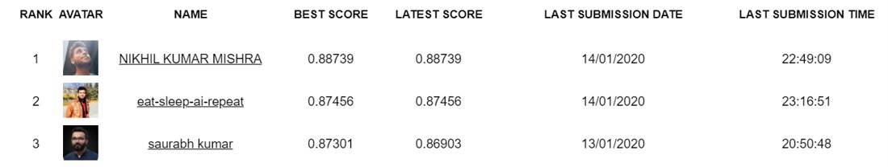

# MachineHack-ZS-Drug-Switch
1st place on the leaderboard solution for the ZS hackathon conducted by MachineHack.

To get the final output run the notebooks in the following order:

1. zs_lgbm_deep_aggs.ipynb
2. zs_magic_recency_lightgbm.ipynb
3. zs_magic_recency_lightgbm_180.ipynb
4. zs_magic_recency_xgboost.ipynb (Best single model LB with AUC of 88.16xxx)
5. zs_magic_recency_xgboost_180.ipynb
